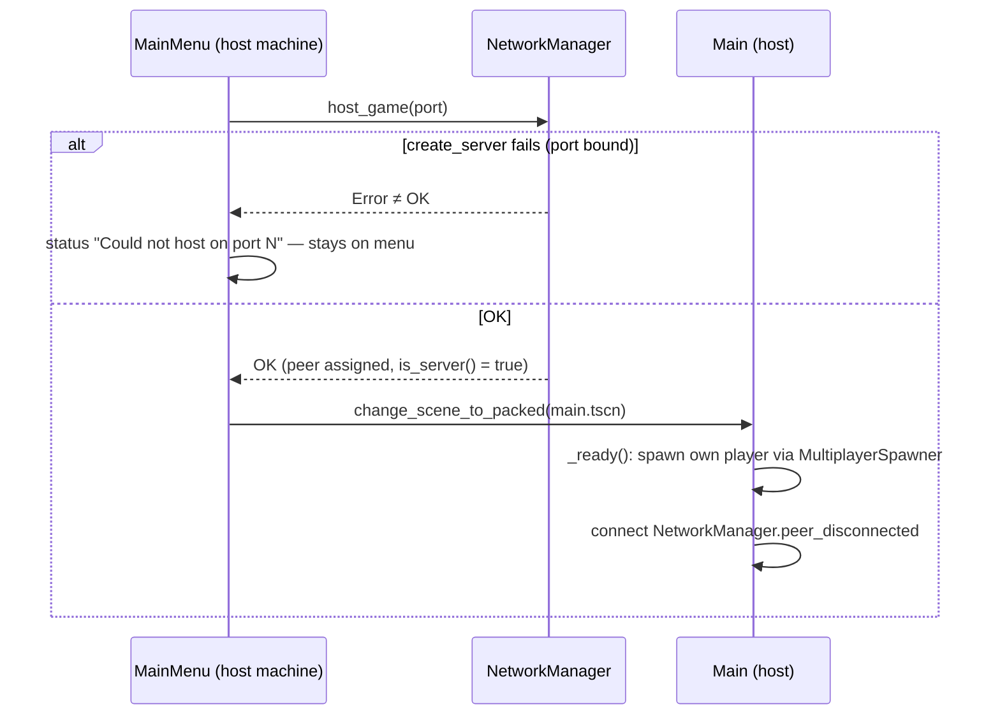
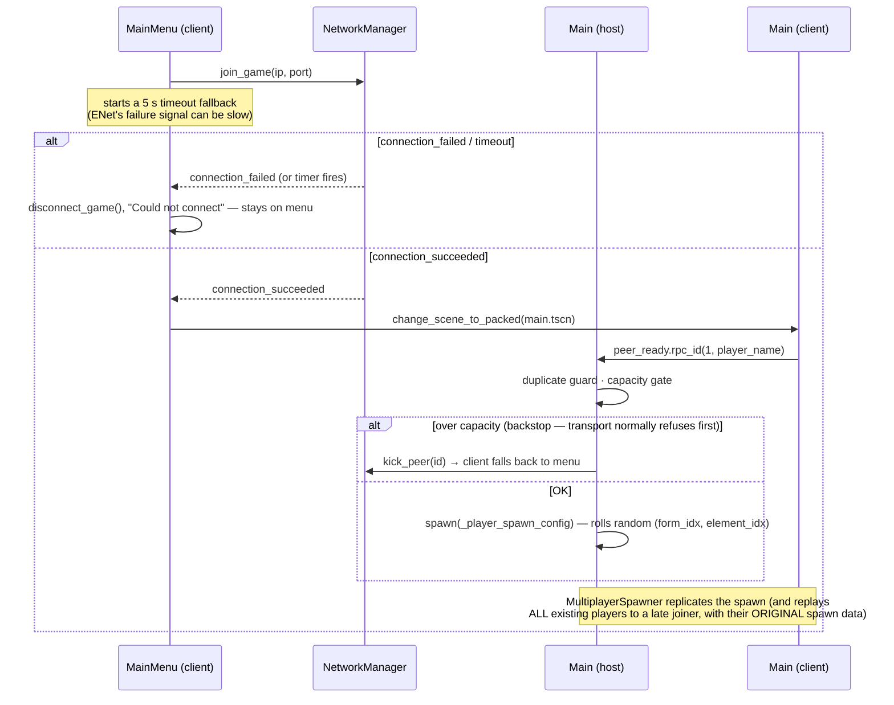
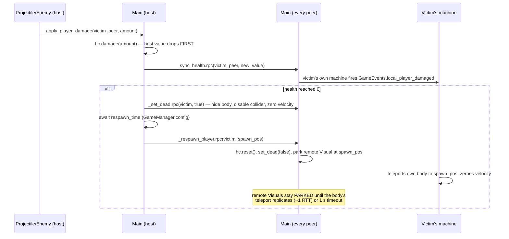

# NETWORKING.md — How Multiplayer Works, Traced

**Charter:** this doc is **reference-led** — it traces what the code actually does, end-to-end,
with real function names, so you can answer "what happens when X?" without reading five files.
It documents behavior; it does not own decisions or rules:

- **Why** it works this way (the authority decision, the friend-co-op trust model) → `DESIGN.md`.
- **Rules, gotchas, and dev workflow** (the `".:prop"` path rule, authority timing, headless
  validation) → `CLAUDE.md`.
- **When you change networking behavior, update this doc in the same PR** (CLAUDE.md workflow
  rule). Code is truth; if this doc and the code disagree, the code wins and this doc has a bug.

---

## 1. Topology & Roles

ENet host/client over UDP. One player **is the server** (the host, peer ID `1`); everyone else
is a client. There is no dedicated server and no relay (yet — see §10).

- Default port: `3000` (`NetworkManager.DEFAULT_PORT`).
- The menu's address field is `ip[:port]`. The optional `:port` applies to **both** join and
  host (`main_menu.gd:_parse_port`); the host ignores the ip half — it always binds locally.
- Capacity: `GameManager.config.max_players` (default 4) **includes the host**. The transport
  is created with `max_clients = max_players - 1`.

## 2. The Transport Seam — `NetworkManager`

`autoloads/network_manager.gd` is the **only** file that knows ENet exists. Everything else
calls four functions and listens to five signals.

| Function | Returns | What it does |
|---|---|---|
| `host_game(port = 3000)` | `Error` | Creates the server peer (`create_server(port, max_players - 1)`). Returns the error **synchronously** (e.g. port already bound) — the caller must not enter the game on failure. Does **not** emit `connection_failed` (that's the client contract). |
| `join_game(ip, port = 3000)` | `Error` | Creates the client peer. A synchronous create failure (bad address/socket) returns the error **and** emits `connection_failed`. The normal failure path (host unreachable) is asynchronous — it arrives later via `connection_failed`. |
| `disconnect_game()` | — | Closes and nulls the peer. Safe to call when already disconnected. |
| `kick_peer(peer_id)` | — | Host-only. Forcibly disconnects a peer through the generic `MultiplayerPeer` API (transport-agnostic). The kicked client receives `server_disconnected` and falls back to its menu. |

| Signal | Fires on | Meaning |
|---|---|---|
| `connection_succeeded` | client | Connected to the host. The menu changes scene to `Main` on this. |
| `connection_failed` | client | Connection attempt failed (async, or sync from `join_game`). |
| `server_disconnected` | client | The host closed the connection (left, crashed, or kicked you). |
| `peer_connected(id)` | all peers | A remote peer joined the session. |
| `peer_disconnected(id)` | all peers | A remote peer left. The host uses this to despawn their player. |

**Swapping the transport** (Steam, WebRTC, relay): replace the peer-creation lines inside
`host_game()` / `join_game()` and touch nothing else — the `multiplayer.*` signal layer above
the transport is identical across backends. The file opens with the formal contract comment.

## 3. The Authority Model (who owns what)

Two kinds of authority coexist, split per the decision in `DESIGN.md`:

| Owned by the **owning peer** (per-player authority) | Owned by the **host** |
|---|---|
| Player movement simulation (`player.gd:_physics_process` runs only on the authority) | Health, damage, death, respawn (`main.gd:apply_player_damage` → RPC value-sync) |
| Input gathering (`PlayerInputSynchronizerComponent`) | Enemies — all AI, movement, melee (`enemy_base.gd`, authority hard-set to `1`) |
| Position — replicates **outward from the owner** | Wave spawning (`wave_director.gd`, host-only loop) |
| Animation drivers: `aim_yaw`, `aim_pitch`, `anim_speed` (owner authors; everyone animates from the replicated value) | Projectiles — movement, lifetime, hit resolution (`projectile.gd`, host-only physics) |
| Cast **intent** (the owner decides when to cast) | Cast **resolution** — rate gate, origin clamp, spawn, damage (`wand_component.gd:_request_cast`) |
| First-person cosmetics (muzzle flash, tracer) | Reactions: burn ticks, lightning chains, damage routing (`reactions.gd`) |
| | All spawning (`MultiplayerSpawner`s in `main.tscn`, host-driven) |

The rule for anything net-new: **clients send intent; the host owns the simulation and
replicates outward.** Client-side feel is local cosmetics only, never authoritative state.

## 4. Node Ownership & Naming

```
Main (Node) — no authority set ⇒ host (peer 1); runs on all peers
├── MultiplayerSpawner            (players  → spawn under Main)
├── ProjectileSpawner             (→ Main/Projectiles)
├── EnemySpawner                  (→ Main/Enemies)
├── TestLevel                     (the swappable level; has PlayerSpawnPosition marker)
├── WaveDirector                  (host-only logic)
├── Reactions                     (host-only logic; authority RPCs fan cosmetics to all)
└── <peer_id> (Player, CharacterBody3D) — authority = owning peer
    ├── PlayerInputSynchronizerComponent — inherits authority (gathers + syncs input)
    ├── MultiplayerSynchronizer          — inherits authority (syncs position/anim outward)
    ├── HealthComponent / HitFlashComponent
    ├── Visual (player_visual.tscn; decoupled `top_level` on REMOTE copies)
    └── CameraRig/Camera3D (only `current` on the owner)
```

**The name-IS-peer-id contract.** A player node is named `str(peer_id)`. Every host lookup
depends on it: `apply_player_damage`, `_sync_health`, `_set_dead`, `_respawn_player`, and
`_on_peer_disconnected` all do `get_node_or_null(str(peer_id))`. This is also how Godot's
high-level multiplayer routes synchronizers and RPCs to the matching node on every peer —
which is why `peer_ready` guards against duplicate spawns (a second node would be auto-renamed
and break the contract).

**Authority timing.** `set_multiplayer_authority()` is called in `_enter_tree()` (never
`_ready()`) so child synchronizers register under the right peer — see the rule in `CLAUDE.md`.

## 5. Replication Reference

Every replicated property in the project. Mode 1 = `ALWAYS` (every network frame),
mode 2 = `ON_CHANGE`. All entries have `spawn = true` (value included in the spawn packet).

| Scene / synchronizer | Property | Mode | Authored by | Consumed by |
|---|---|---|---|---|
| `player.tscn` MultiplayerSynchronizer | `.:global_position` | 1 | owning peer's physics | every remote peer (body snaps; Visual eases toward it) |
| | `.:aim_yaw` | 1 | owner (`_process`, from camera yaw) | remote Visual facing (smoothed) |
| | `.:aim_pitch` | 1 | owner (camera pitch) | remote spine-pitch modifier |
| | `.:anim_speed` | 1 | owner (post-`move_and_slide` planar speed) | every peer's locomotion blend |
| `player_input_synchronizer_component.tscn` (`root_path = "."`) | `.:movement_vector` | 2 | owner (`Input.get_vector`) | **owner only** — no remote consumer today; kept deliberately as the seam for host-side validation / prediction (see CLAUDE.md note) |
| | `.:is_jump_pressed` | 2 | owner | owner only (same seam) |
| `enemy_base.tscn` MultiplayerSynchronizer | `.:global_position` | 1 | host AI | clients (snapped — remote-enemy smoothing is a deferred follow-up) |
| | `.:anim_speed` | 1 | host (post-slide) | every peer's locomotion blend |
| | `.:face_yaw` | 1 | host (toward target) | every peer's Visual facing |
| `projectile.tscn` MultiplayerSynchronizer | `.:global_position` | 1 | host physics | clients (visual position) |

**Remote-body smoothing.** Mode-1 values are applied with **no interpolation** — a remote body
teleports between packets *by design* (collision and host hit-resolution need the true
position). On remote player copies the visible `Visual` is decoupled (`top_level = true`) and
eased toward the body by `RemoteVisualSmoother` (`1 - exp(-rate·delta)` weight, snap guard at
5 m, respawn park). **Never lerp the body itself** — smooth the Visual. Full rationale:
`CLAUDE.md` → Replication Modes / Known Issues.

**Health is never replicated by a synchronizer.** It flows host → all via the `_sync_health`
reliable RPC (value-sync), because synchronizer-replicated health can desync. See §8.

## 6. RPC Catalog

Every `@rpc` in the codebase. All are `reliable`.

| Method | File | Mode | Direction | Purpose |
|---|---|---|---|---|
| `peer_ready(p_name)` | `main.gd` | `any_peer, call_remote` | client → host | "Spawn me." Host guards: duplicate-name check, capacity gate (kicks when over). |
| `_sync_health(peer, value)` | `main.gd` | `authority, call_local` | host → all | Push the authoritative health value; fires the local damage cue on the victim's machine. |
| `_set_dead(peer, dead)` | `main.gd` | `authority, call_local` | host → all | Toggle death state (`Player.set_dead`). |
| `_respawn_player(peer, pos)` | `main.gd` | `authority, call_local` | host → all | Reset health, un-dead, park the remote Visual at the spawn point; the victim's own machine teleports its body. |
| `play_cast_anim()` | `player.gd` | `authority, call_local` | **owner** → all | Cosmetic cast gesture + SFX. Works because the player node's authority IS its owner. |
| `play_attack_anim()` | `enemy_base.gd` | `authority, call_local` | host → all | Cosmetic enemy swing (host IS the enemy's authority). |
| `_request_cast(origin, dir)` | `wand_component.gd` | `any_peer, call_remote` | client → host | Cast intent. Host enforces the cast rate on its copy of the wand (jitter tolerance), clamps origin near the body, re-normalizes direction. |
| `_request_set_blend(f, e)` | `wand_component.gd` | `any_peer, call_remote` | client → host | Equip-change request (debug cycle now; pickups later). |
| `_set_blend(f, e)` | `wand_component.gd` | `any_peer, call_local` | host → all ⚠ | Equip broadcast. **Sanctioned `any_peer` exception** — see below. |
| `flash_remote()` | `hit_flash_component.gd` | `any_peer, call_local` | host → all ⚠ | Cosmetic hit flash. **Sanctioned `any_peer` exception.** |
| `show_chain(points, color)` | `reactions.gd` | `authority, call_local` | host → all | Cosmetic lightning arcs. |
| `show_burst(center, color, r)` | `reactions.gd` | `authority, call_local` | host → all | Cosmetic burst flash. |
| `set_unit_burning(path, on)` | `reactions.gd` | `authority, call_local` | host → all | Cosmetic burn glow attach/remove. |

**⚠ The `any_peer` host-broadcast exception.** `_set_blend` and `flash_remote` live on
**client-owned** player nodes. When the host fans a broadcast to such a node it is **not** that
node's authority, so an `"authority"` RPC would be rejected. They use `any_peer` instead,
guarded so only the host originates them (`is_server()` checks upstream). The `Reactions`
cosmetics do **not** need this — that node sits under `Main` with default authority 1, so plain
`authority` RPCs work. Don't "fix" the exceptions back to `authority`; don't copy the exception
where `authority` suffices.

## 7. Lifecycles

### Host boot



### Client join (and late join)



### Damage → death → respawn



### Disconnects

| Who leaves | What happens |
|---|---|
| **A client** | Host gets `peer_disconnected(id)` → `Main._on_peer_disconnected` `queue_free`s `Main/<id>`; the despawn replicates to everyone via the spawner. |
| **The host** | Every client gets `server_disconnected` → `Main._on_server_disconnected`: pause the tree (halts per-frame RPC/synchronizer work that would crash against the null peer), show the "host left" HUD overlay, wait 2.5 s, return to the menu. |
| **A kicked peer** | Same as "the host left" from the kicked client's point of view (it receives `server_disconnected`). |

## 8. The Health Pattern (value-sync, not state-sync)

Health is **host-computed, RPC-pushed**: the host applies `hc.damage()` and then broadcasts the
resulting value with `_sync_health.rpc(...)`. Two consequences worth internalizing:

1. **Never replicate health through a `MultiplayerSynchronizer`** — interleaved with damage
   RPCs it can desync. The value-sync RPC is the single writer on every peer.
2. **Host/client timing asymmetry.** The host pre-applies the damage *before* the RPC lands, so
   on the host the local `current_health` already equals the new value when `_sync_health`
   runs. **Never gate a cue on `value < current_health`** — it's false on the host and the cue
   silently no-ops there (a real bug we shipped and fixed). Emit on the fact that a damage sync
   arrived (`_sync_health` is only ever sent for damage; respawn resets go through
   `_respawn_player`).

## 9. Edge-Case Matrix

| Scenario | Behavior | Handled in |
|---|---|---|
| Host port already bound (e.g. second host on one machine) | `host_game` returns the error; menu shows "Could not host on port N (already in use?)" and stays put | `network_manager.gd:host_game`, `main_menu.gd:_on_host_pressed` |
| Join to a dead/unreachable address | 5 s timeout fallback fires → `disconnect_game()` + "Could not connect"; a stale timer from an older attempt is ignored via an attempt token | `main_menu.gd:_on_join_timeout` |
| Join fails synchronously (bad address) | `join_game` emits `connection_failed` → same failure path | `network_manager.gd:join_game` |
| 5th peer tries to join (capacity 4) | Refused at the transport (`max_clients = max_players - 1`) → client sees `connection_failed` at the menu | `network_manager.gd:host_game` |
| Over-capacity peer somehow connects (config race) | `peer_ready` kicks it; the client falls back to its menu via `server_disconnected` | `main.gd:peer_ready`, `network_manager.gd:kick_peer` |
| Duplicate `peer_ready` from the same peer | Ignored — a node named `str(peer_id)` already exists | `main.gd:peer_ready` |
| Client sends cast RPCs faster than `cast_delay_sec` | Host drops them — its copy of the wand takes the cooldown too (0.1 s jitter tolerance so honest casts survive) | `wand_component.gd:_request_cast` |
| Client supplies a forged far-away cast origin | Clamped to within 4 m of the caster's authoritative body | `wand_component.gd:_clamp_origin_to_body` |
| Dev console open | Look blocked (`player.gd:_input`), move/jump zeroed (`gather_input`), cast blocked (mouse not captured while console frees it) | `GameManager.console_open`, `dev_console.gd:_toggle` |
| Player dies | Collider disabled (deferred), velocity + `anim_speed` zeroed, body/name hidden; enemies retarget (AI skips `is_dead()`); further hits ignored (`current_health <= 0` guard) | `player.gd:set_dead`, `main.gd:apply_player_damage` |
| Cast input while dead | Ignored — `_process` returns before the cast branch; `_on_cast_released` also guards `_dead` | `player.gd` |
| Caster's own bolt at the muzzle | Direct hits on own body ignored; the caster **can** still be caught in their own burst (friendly-fire comedy) | `projectile.gd:_on_body_entered` |
| Respawn teleport vs. lagging replication | Remote Visuals snap to the broadcast spawn point and **park** until the body's teleport replicates (or 1 s timeout) | `remote_visual_smoother.gd:teleport`, `main.gd:_respawn_player` |
| Damage cue on the host | See §8 — never compare before/after values | `main.gd:_sync_health` |
| **KNOWN GAP — late join, stale state** | A late joiner receives every player's **original** spawn data: a damaged player shows full health, a dead player stands at the death spot, and a player who swapped spells shows the spawn-rolled blend until the next sync event. Needs a host→new-peer state push on `peer_connected`. | (unhandled; audit P7) |
| **KNOWN GAP — single spawn point** | All spawns/respawns use one `PlayerSpawnPosition`; simultaneous spawns shove each other (players collide). Spawn-point system is a roadmap item. | `main.gd` |
| **KNOWN GAP — remote enemies stutter** | Enemy `global_position` is snapped with no Visual smoothing; `RemoteVisualSmoother` was built to be reused for them (deferred — slow/distant motion hides it for now). | `enemy_base.tscn` |

## 10. Reusing the Spine (the framework story)

The codebase deliberately splits into a **game-agnostic spine** and **game-specific systems**.
(Per `DESIGN.md`, the reusable-framework future earns no *architectural* weight until a second
game needs it — but the seams already exist and cost nothing to keep clean.)

**Game-agnostic (carries to any host-client co-op game):**

- `NetworkManager` — the transport seam (§2). Swap ENet for `SteamMultiplayerPeer` or a relay
  peer inside `host_game`/`join_game`; nothing else changes.
- `GameManager` + `GameConfig` — session config the host sets pre-game; the natural place for a
  future `selected_level` field + broadcast.
- `GameEvents` — the autoload signal bus (cross-system communication without node references).
- The **spawner pattern** — `MultiplayerSpawner` + a `spawn_function` fed a flat config
  `Dictionary` of primitives. Players, projectiles, and enemies all use it; any new replicated
  entity should too. Late joiners get existing entities replayed automatically.
- `PlayerInputSynchronizerComponent` — owner-gathered, mode-2-synced input (and the documented
  seam for host validation / prediction).
- The **health pattern** (§8) — `HealthComponent` + host RPC value-sync.
- `HitFlashComponent` — reusable cosmetic feedback incl. the `any_peer` broadcast exception.
- The **DEBUG autoload** — two-window autostart + the headless smoke driver (`debug/debug.gd`,
  `tools/smoke-test.sh`).
- The menu's connect/host flow incl. all §9 failure handling.

**Game-specific (replace per game):** the player controller, the spell system
(`systems/spells/`, see `docs/SPELLS.md`), `Reactions`, `WaveDirector`, enemy AI, the level
scene, the HUD.

**Standing up a new game on the spine — checklist:**

1. Keep `autoloads/` (all four), `components/` (input sync, health, hit flash), `debug/`,
   `tools/`, the menu, and `main.tscn`'s spawner + `peer_ready` skeleton.
2. Replace `TestLevel` with your level — `main.gd` finds `PlayerSpawnPosition` via
   `find_child`, so any level with that marker works.
3. Replace the `Player` scene; keep the contract: node named `str(peer_id)`, authority set in
   `_enter_tree`, position + animation **drivers** replicated mode 1, `class_name Player`
   (Main's `spawn_function` casts to it).
4. For every new networked entity: host-authoritative, spawned via a `MultiplayerSpawner`
   `spawn_function` with a flat primitives config, authority set to `1` in `_enter_tree`.
5. For every new client action: an `any_peer, call_remote` intent RPC to the host, validated
   there; cosmetic feedback fans out via `authority, call_local` (or the `any_peer` exception
   if the node is client-owned).
6. Re-read §9 and make each row true for your game.
