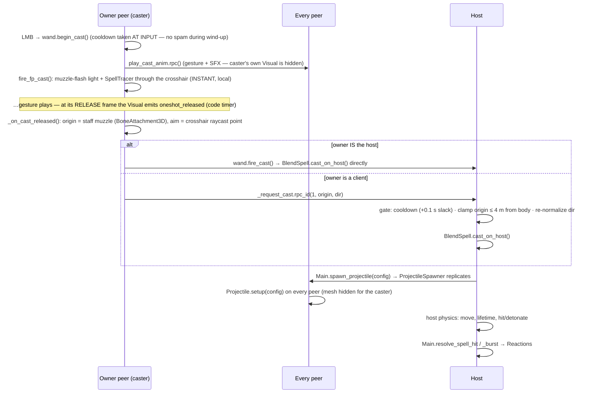

# SPELLS.md — The BLEND Spell System, Traced

**Charter:** reference-led — what every spell class does, which properties live where, and how
a cast flows from input to damage, with real function names. The *decisions* (why blend instead
of Noita-style sequencing, the ~7-Form ceiling, randomness-as-keystone) live in `DESIGN.md`;
structure rules live in `CLAUDE.md`; dev workflow + gotchas live in `docs/DEV.md`. **When you
change spell behavior, update this doc in the same PR.** Code is truth.

---

## 1. The Concept in One Paragraph

A spell is a **blend**: one **Form** (delivery shape — where the mechanical distinctness lives)
fused with one **Element** (damage + reaction layer) into a single `BlendSpell`. One cast = one
fused effect, never a sequence or program. The slice ships 2 Forms × 2 Elements = 4 blends:

| | **Fire** (el 0) | **Lightning** (el 1) |
|---|---|---|
| **Projectile** (form 0) | Firebolt | Spark |
| **Burst** (form 1) | Fireball | Thunderclap |

### The INDEX-STABLE contract

Spell picks travel the wire as **catalog indices** (`form_idx`, `element_idx`) — in the player
spawn config and in the equip-sync RPC — and every peer rebuilds the identical spell locally via
`SpellCatalog.make_blend(f, e)`. The order of the catalog arrays **is the network protocol**:
**append new entries, never reorder or remove.** Nothing validates this at runtime — it's a
discipline rule.

## 2. Class Reference

### `Spell` — `games/magick/spells/spell.gd` (`Resource`)

The base seam. `WandComponent` holds one; subclasses implement the actual effect.

| Member | Kind | Default | Meaning |
|---|---|---|---|
| `display_name` | `@export String` | `"Spell"` | UI label; `describe()` returns it |
| `cast_on_host(arena, origin, direction, caster_peer)` | virtual | no-op | **Host-only** execution point — produce the effect by asking `arena` (Main) to spawn things |
| `muzzle_color()` / `cast_sound()` | virtual | white / null | Cosmetic feedback params |
| `projectile_speed()` / `projectile_lifetime()` | virtual | 28.0 / 3.0 | Used by the caster's local tracer so it matches the real bolt |

The `cast_on_host` seam exists so a differently-shaped spell (e.g. the deferred `CascadeSpell`
experiment) can slot in without touching the wand.

### `SpellForm` — `games/magick/spells/spell_form.gd` (`Resource`)

The delivery shape. Element-agnostic.

| `@export` | Type | Default | Meaning |
|---|---|---|---|
| `display_name` | String | `"Projectile"` | |
| `projectile_speed` | float | 28.0 | u/s |
| `projectile_lifetime_sec` | float | 3.0 | despawn timer |
| `aoe_radius` | float | 0.0 | `0` = single-target; `> 0` = burst radius |
| `explode_on_impact` | bool | false | detonate on first contact (or at lifetime end) into `aoe_radius` |

### `SpellElement` — `games/magick/spells/spell_element.gd` (`Resource`)

The damage + reaction layer. `enum Reaction { NONE, FIRE, LIGHTNING }`.

| `@export` | Type | Default | Meaning |
|---|---|---|---|
| `display_name` | String | `"Fire"` | |
| `damage` | int | 25 | direct-hit damage |
| `color` | Color | orange | projectile mesh + muzzle flash + arc/burst tint (the per-element legibility color) |
| `cast_sound` | AudioStream | — | per-element cast SFX (cosmetic, played locally on every peer) |
| `reaction` | Reaction | NONE | which reaction block below applies |
| `chain_count` / `chain_range` / `chain_falloff` | int / float / float | 0 / 6.0 / 0.6 | LIGHTNING: max extra jumps / jump distance / damage multiplier per jump |
| `burn_dps` / `burn_duration_sec` | int / float | 0 / 0.0 | FIRE: DoT rate and length |

### `BlendSpell` — `games/magick/spells/blend_spell.gd` (extends `Spell`)

Fuses `@export var form: SpellForm` + `@export var element: SpellElement`. Its `cast_on_host`
**flattens both into a flat Dictionary of primitives** (no Resource crosses the wire) and calls
`arena.spawn_projectile(config)`. Config keys: `pos, dir, speed, lifetime, aoe_radius, explode,
damage, color, reaction, chain_count, chain_range, chain_falloff, burn_dps, burn_duration,
owner`. Cosmetic getters read from the element (color/SFX) and form (speed/lifetime).
`describe()` prefers the themed `display_name`, falling back to `"<Element> <Form>"`.

### `SpellCatalog` — `games/magick/spell_catalog.gd` (autoload `Node`)

The single source of truth for what can be cast — and the future loot table for pickups.

- `forms: Array[SpellForm]` / `elements: Array[SpellElement]` — built **in code** in `_ready()`
  (no `.tres` files yet). Slice content: Projectile (28 u/s), Burst (18 u/s, radius 3,
  explodes); Fire (22 dmg, burn 6 dps × 3 s), Lightning (20 dmg, chain 2 jumps, 6 m, ×0.6).
- `make_blend(form_idx, element_idx) -> BlendSpell` — called identically on every peer; index
  access is clamped (a bad index can't crash, it just builds the edge entry).
- `blend_name(f, e)` — themed names from the `_NAMES` dict keyed `"form_idx,element_idx"`
  (`"0,0": "Firebolt"` …), fallback `"<Element> <Form>"`.
- `form_count()` / `element_count()` — used by the random deal and the debug cycle.

### `WandComponent` — `games/magick/spells/wand_component.gd` (`Node`)

Holds the equipped spell, gates the cast rate, and routes casting. **Added in code** by
`player.gd:_ready` on *every* peer's copy of the player (same node path on all peers — RPC
routing needs that).

| Member | Kind | Default | Meaning |
|---|---|---|---|
| `equipped_spell` | `@export Spell` | null → built from indices in `_ready` | |
| `cast_delay_sec` | `@export float` | 0.35 | cooldown between casts |
| `host_cast_gate_tolerance_sec` | `@export float` | 0.1 | host-gate slack for network jitter (see `_request_cast`) |
| `max_cast_origin_offset_m` | `@export float` | 4.0 | how far a client-supplied origin may sit from the body before the host pulls it back |
| `form_idx` / `element_idx` | var | 0 / 0 | catalog indices, set by `player.gd` before tree entry |

Key methods: `begin_cast()` (gate + take cooldown **at input**, owner-side), `fire_cast(origin,
dir)` (the networked bolt — direct `cast_on_host` on the host, `_request_cast` RPC from a
client), `fire_fp_cast(origin, dir, max_dist)` (instant caster-only cosmetics: muzzle-flash
light + `SpellTracer`), `request_set_blend(f, e)` (equip change via host broadcast),
`cast_sound()` / `current_spell_text()` (forwarders for player/HUD).

RPCs: see the catalog in `docs/NETWORKING.md` §6. Note `_request_cast` is where the **host
enforces** the cast rate (its copy's `_cooldown` ticks on every peer; only this RPC sets it on
the host copy) and clamps the client-supplied origin.

### `Projectile` — `games/magick/projectiles/projectile.gd` (`Area3D`)

The host-authoritative networked bolt. Spawned on **every** peer by Main's `ProjectileSpawner`
with the same config (visuals match); only the host moves it and resolves hits.

- `setup(config)` runs on every peer before `_ready`: unpacks the flattened blend, keeps the
  reaction payload in `_params` to forward verbatim on hit.
- Collision: layer 8 (`projectiles`); mask **6** (players + enemies, flies through walls) for
  single-target, switched to **7** (+world) for bursts so they detonate on floors/walls.
- Host `_physics_process`: move, tick lifetime; at lifetime end a burst detonates, a bolt
  despawns.
- `_on_body_entered` (host): ignores the **caster's own body** (no muzzle self-hit — but a
  burst's radius *can* still catch the caster); single-target resolves on the first
  player/`HealthComponent` contact via `Main.resolve_spell_hit`; bursts call `_detonate()` →
  `Main.resolve_spell_burst`.
- **FP dual-visual:** the mesh is hidden when `_owner_peer == multiplayer.get_unique_id()` —
  the caster sees their local tracer instead, everyone else sees this bolt leave the staff. The
  hidden bolt still does **all** the damage (Area3D monitoring ignores mesh visibility).

### `SpellTracer` — `games/magick/projectiles/spell_tracer.gd` (`MeshInstance3D`)

The caster-only cosmetic bolt: flies dead-straight from just ahead of the camera **through the
crosshair**, so the caster's shot reads as going where they aimed. Never networked, no
collision, zero damage. Frees itself at the crosshair-hit distance (`max_dist`) or at the
spell's lifetime, whichever comes first. Spawned by `WandComponent.fire_fp_cast` at input time.

### `Reactions` — `games/magick/reactions/reactions.gd` (`Node` under Main)

The reaction table + the single home for spell-hit **damage routing**. Host-only logic;
cosmetics fan to all peers via `authority` RPCs (this node is host-owned, unlike player nodes).

**Why host-central, not a per-entity component:** a player node's authority is its *owning
peer*, so a self-ticking burn component would tick on the wrong machine. The burning registry +
tick live here, on the host.

- `apply_hit(victim, params, caster_peer)` — direct damage + status; LIGHTNING then chains.
- `apply_burst(center, radius, params, caster_peer)` — damage + status to every unit in radius
  (group-based query, no physics casts). For Lightning the burst IS the spread — no extra
  chain, but center→unit arcs are drawn for legibility.
- `_deal(unit, dmg, …)` — **the routing rule:** a `Player` goes through
  `Main.apply_player_damage` (host RPC value-sync); anything else gets
  `HealthComponent.damage()` directly (enemies are host-owned).
- `_ignite` / `_physics_process` — the burn registry (`unit → {dps, remaining, accum,
  source}`). Fractional damage accumulates in `accum` and is dealt in whole points (no
  float-rounding loss). Re-igniting refreshes duration but keeps the accumulator. Expiry or
  death removes the glow via `set_unit_burning.rpc(path, false)`.
- `_chain` — up to `chain_count` jumps to the nearest unhit unit within `chain_range`, damage
  ×`chain_falloff` per jump, **allies included** (friendly-fire comedy is a design pillar).

### Shared components

- **`HealthComponent`** (`framework/components/health_component.gd`): `@export max_health` (100 default;
  enemies override to 40 in `enemy_base.tscn`), `current_health`, `damage(amount)` (clamps,
  emits `damaged` then `died` at 0), `reset()`. Players: host-only writes + RPC value-sync.
  Enemies: host-only direct writes.
- **`HitFlashComponent`** (`framework/components/hit_flash_component.gd`): cosmetic damage flash via a
  transient `material_overlay` (preserves textures, per-instance, no bleed). Auto-wires to a
  `HealthComponent.damaged`; the **host** fans `flash_remote.rpc()` to all peers
  (`any_peer` exception — see NETWORKING §6). `skip_on_lethal` avoids tweening an entity being
  freed the same frame.

## 3. The Cast Pipeline

Two timings to keep straight:

- **Cooldown at input, bolt at release.** `begin_cast()` takes the cooldown the moment the
  button is pressed; the networked bolt spawns later, at the gesture's release frame
  (`oneshot_release_time_sec` on the Visual's `LocomotionAnimator` — a code timer, not an
  animation Call Method track). The caster never feels the gap because their tracer + flash
  fired instantly at input.
- **The FP/TP dual-visual split.** Caster sees: local tracer from screen-center (cosmetic).
  Everyone else sees: the networked bolt leave the actual staff. Damage comes **only** from the
  networked bolt — which is mesh-hidden on the caster's machine but still collides.

## 4. Hit Resolution & Reactions

| | Single-target (Projectile) | AoE Burst |
|---|---|---|
| Collision mask | 6 — flies through walls | 7 — detonates on world too |
| Resolves | first Player/`HealthComponent` body touched | every unit in `aoe_radius` at detonation |
| Entry point | `Main.resolve_spell_hit` → `Reactions.apply_hit` | `Main.resolve_spell_burst` → `Reactions.apply_burst` |
| Fire reaction | burn the victim | burn every unit in radius |
| Lightning reaction | chain outward (`chain_count` jumps, falloff) | the burst IS the spread — center→unit arcs drawn, no extra chain |
| Caster safety | own body can't trigger it | caster **can** be caught in own burst |

Damage routing is always `Reactions._deal`: players → `Main.apply_player_damage` (RPC
value-sync, see NETWORKING §8), enemies → `HealthComponent.damage()` direct. Friendly fire is
ON by design — projectiles hit players and enemies alike.

## 5. The Cosmetic Layer (what's local vs. broadcast)

| Effect | Scope | Mechanism |
|---|---|---|
| Muzzle flash (OmniLight) | caster only | `WandComponent._spawn_local_muzzle_flash`, at input |
| `SpellTracer` bolt | caster only | `fire_fp_cast`, at input |
| Cast gesture (upper-body one-shot) | every peer | `play_cast_anim` RPC → `LocomotionAnimator.fire_oneshot` |
| Cast SFX | every peer | same RPC → `_play_cast_sfx`: caster hears 2D non-positional, remotes hear 3D positional from the body |
| Hit flash | every peer | host fans `HitFlashComponent.flash_remote.rpc()` |
| Lightning arcs | every peer | `Reactions.show_chain.rpc` (emissive box segments, fade 0.22 s) |
| Burst flash | every peer | `Reactions.show_burst.rpc` (OmniLight, fade 0.3 s) |
| Burn glow | every peer | `Reactions.set_unit_burning.rpc` (a `BurnFlame` OmniLight child) |

Nothing in this table touches game state. Per-element **color** is the legibility carrier
(DESIGN's acceptance bar) — it flows from `SpellElement.color` into the bolt mesh, tracer,
muzzle flash, arcs, and burst light.

## 6. How To Add Content

**A new Element** (e.g. Ice):
1. `spell_catalog.gd`: write a `_ice()` builder (display_name, damage, color, cast SFX preload,
   reaction params) and **append** it to `elements` in `_ready()` — never insert or reorder
   (index-stable contract, §1).
2. If it needs a new reaction: add it to `SpellElement.Reaction`, add tuning `@export`s on
   `SpellElement`, flatten them into the config in `blend_spell.gd:cast_on_host`, unpack them
   in `projectile.gd:setup`'s `_params`, and implement the behavior in `reactions.gd`
   (`_apply_direct_and_status` or a new branch).
3. Optionally add themed names to `_NAMES` for each `"form_idx,element_idx"` pairing.
4. Done — the random deal (`main.gd:_player_spawn_config` rolls `randi() % element_count()`),
   the debug `B`-cycle, and the console `give` all pick it up automatically.

**A new Form** (e.g. Beam): same append-to-catalog flow, but Forms carry the mechanics — if it
isn't a projectile variant (speed/lifetime/aoe flags), it needs its own delivery implementation
behind `cast_on_host` (a new spawned entity following the host-authoritative spawner pattern,
NETWORKING §10 step 4). Mind the ~7-Form ceiling decision in `DESIGN.md`.

**Changing what a player holds at runtime:** always go through
`WandComponent.request_set_blend(f, e)` — it resolves on the host and broadcasts `_set_blend`
so every peer rebuilds the identical wand. (The pickup/keep-or-swap loop that would have used
this seam was cut by the framework reframe — the seam itself stays, exercised by the console
`give` and the debug B-cycle.) Note the late-join caveat: a joiner rebuilds wands from
**original spawn data**, so equip changes made before they joined aren't reflected (known gap,
NETWORKING §9).
